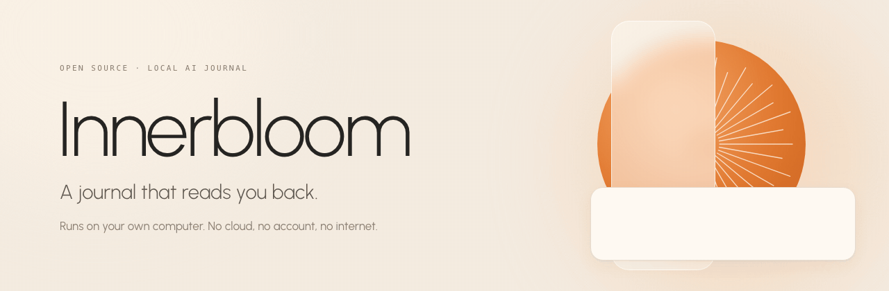
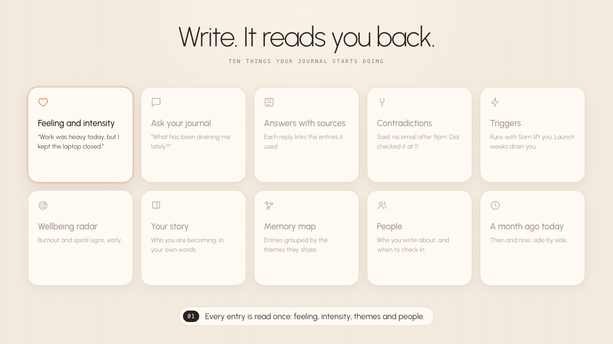
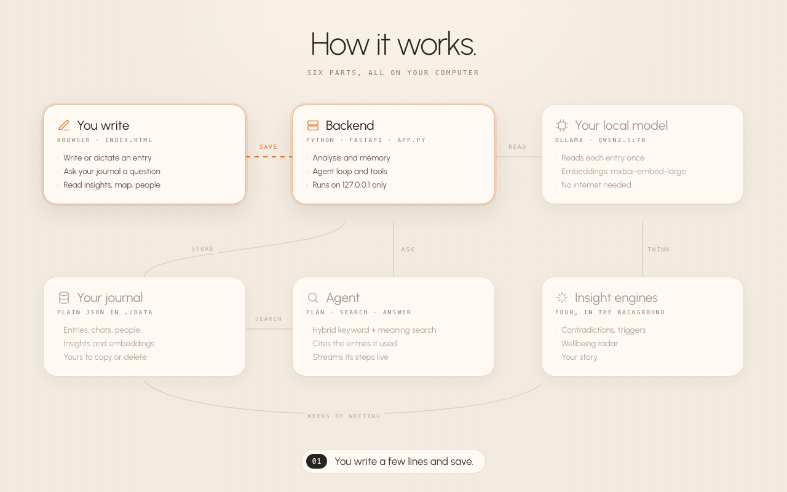
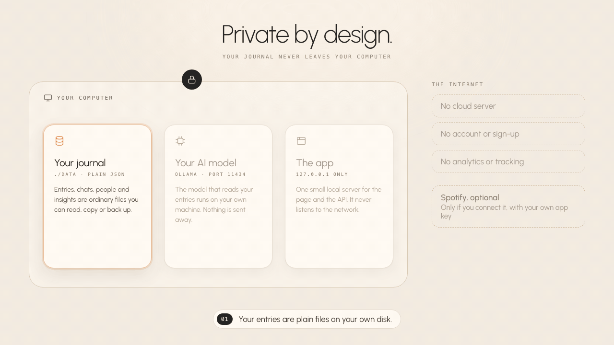

<p align="center"></p>

<p align="center">
  <a href="https://ghanshyampaunikar.com/innerbloom"></a>
  <a href="https://ghanshyampaunikar.com/"></a>
  <a href="https://www.linkedin.com/in/ghanshyampaunikar/"></a>
  <a href="https://medium.com/@ghanshyampaunikar/ai-journal-for-my-mental-health-8a687edb13db"></a>
  <a href="https://www.instagram.com/ghanshyampaunikar/"></a>
  <a href="https://github.com/GhanshyamPaunikar"></a>
</p>

<h1 align="center">Innerbloom</h1>

<p align="center"><b>A journal that reads you back.</b></p>

<p align="center">An open-source AI journal that runs on your own computer.<br>Write the way you always do. It notices the feeling, the people and the patterns,<br>answers questions about your own life, and never sends a word to the cloud.</p>

<p align="center"><b><a href="https://ghanshyampaunikar.com/innerbloom">Try the live demo</a></b> · <a href="#get-started">Run it yourself</a> · <a href="docs/ARCHITECTURE.md">How it works inside</a></p>

<br>


https://github.com/user-attachments/assets/96337b4e-9c80-4f42-8095-d7b92266657f


<p align="center"><sub>Product tour · sound on</sub></p>

<br>

## Write. It reads you back.

<p align="center"></p>

<details>
<summary>Read all ten</summary>
<br>

**"Work was heavy today, but I kept the laptop closed."**<br>
You save, and it reads the entry once: frustrated, 6 out of 10, about work and boundaries, with Jane mentioned. No forms to fill in.

**"What has been draining me lately?"**<br>
Ask anything. An agent searches your past entries by meaning, not just by words, and answers like a friend who has read every page.

**Answers with sources.**<br>
Every answer links the exact entries it drew from. Click one and it opens.

**Contradictions.**<br>
You promised yourself no work email after 9pm. A week later you checked it at 11. It notices, gently, and shows both entries side by side.

**Triggers.**<br>
Runs with Sam reliably lift your mood. Launch weeks reliably drain it. It finds what moves you, with the evidence.

**Wellbeing radar.**<br>
Early, quiet warnings when burnout or a low spiral starts to build, rated ok, watch, elevated or high.

**Your story.**<br>
Who you are, in your own words: the values you act on, the tensions you carry, and who you are becoming.

**Memory map.**<br>
Entries that share a theme gather into named groups. Pick a memory and see everything it connects to.

**People.**<br>
Everyone you write about, how they tend to make you feel, and gentle reminders when it has been a while.

**A month ago today.**<br>
Then and now, side by side: what stayed, what shifted, and what you are still avoiding.

</details>

<br>

## Compared with a cloud AI journal.

| | Innerbloom | Typical cloud AI journal |
|---|:---:|:---:|
| Your entries stay on your own computer | ✅ Yes | ❌ No |
| Works with no internet connection | ✅ Yes | ❌ No |
| No account, no subscription | ✅ Yes | ❌ No |
| Answers cite the exact entries they used | ✅ Yes | ❌ Rarely |
| Contradictions, triggers and burnout signals | ✅ Yes | ❌ Rarely |
| You choose and swap the AI model | ✅ Yes | ❌ No |
| Your journal is plain files you can read and copy | ✅ Yes | ❌ No |
| Open source | ✅ Yes | ❌ No |

<br>

## How it works.

<p align="center"></p>

Six parts, all on your computer. Here is the path one entry takes.

**1 · You write.** A quiet page in your browser. Type, or dictate with speech recognition that stays on your device.

**2 · Your local model reads it.** A small Python server (FastAPI) asks the model running in Ollama to read the entry once: the feeling, how intense it was, the themes, and the people in it.

**3 · It understands meaning.** The entry is embedded too, so search finds "being overlooked" when you ask about feeling unappreciated.

**4 · It is saved as plain files.** Entries, chats, people and insights are JSON in `./data`. Yours to read, back up, or delete.

**5 · You ask, an agent answers.** It plans, searches your entries, and streams an answer with clickable sources. Pick a voice: Companion, Observer or Challenger.

**6 · Insights grow in the background.** Four engines look across weeks of writing for contradictions, triggers, burnout and the story you are living.

The details, from chunked embeddings to how contradictions stay grounded in your own words, are in **[docs/ARCHITECTURE.md](docs/ARCHITECTURE.md)**.

<br>

## Private by design.

<p align="center"></p>

There is no company in the middle. Your journal lives where you put it.

- **On your computer.** The page, the API and the AI model all run locally. The app only listens on `127.0.0.1`.
- **Plain files.** Your journal is readable JSON in `./data`. Copy it, back it up, or delete the folder and every trace is gone.
- **No cloud, no account.** Nothing to sign up for, no analytics, no tracking.
- **Nothing to download at runtime.** Fonts, images and scripts are bundled. No CDN.
- **Spotify is optional.** Music and mood only talks to Spotify if you connect it, with your own app.
- **There when it matters.** If your writing suggests you are in crisis, it shows helplines alongside its reply.

<br>

## Get started.

**The easy way: download the app.** Innerbloom for Mac and Windows is on the [Releases page](https://github.com/GhanshyamPaunikar/innerbloom/releases/latest). Open it and it walks you through the rest: installing Ollama and downloading the AI, about 7 GB, once. No coding tools needed.

**From the source**, if you want to change it: you need Python 3.10+ and [Ollama](https://ollama.ai).

```bash
git clone https://github.com/GhanshyamPaunikar/innerbloom.git
cd innerbloom
pip install -r requirements.txt
ollama pull qwen2.5:7b && ollama pull mxbai-embed-large
python scripts/get_reader.py   # optional: the fast entry reader, 1.9 GB
python run_local.py
```

Then open **http://127.0.0.1:5000/app** and start writing.

Want to look around first? `python run_local.py --demo` opens a fictional journal with simulated AI, or try the **[live demo](https://ghanshyampaunikar.com/innerbloom)** in your browser.

Choosing a model, settings, Spotify, tests and the full API are in **[docs/SETUP.md](docs/SETUP.md)**.

**Cost: nothing.** Every model it uses is free and runs on your machine.

<br>

## Contributing

Issues and pull requests are welcome. Run the tests with `python tests/test_app.py` and `python -m unittest tests.test_workspace tests.test_public_demo`.

Font: Urbanist, under the SIL Open Font License (see `assets/fonts/`). MIT licensed, see [LICENSE](LICENSE).
